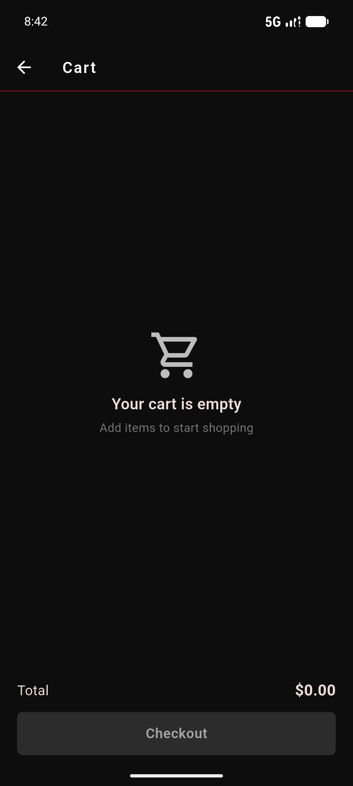

# Mini Catalog

A small product catalog app made with Flutter. It has a home page with search and a product grid, a product detail page and a simple cart. Product data is read from a local JSON file.

**Flutter version:** 3.50.0 (Dart 3.14.0)

## How to run

```bash
git clone https://github.com/Azragull/minicatalog.git
cd minicatalog
flutter pub get
flutter run
```

## Screenshots

| Home | Detail | Cart | Empty cart |
|------|--------|------|------------|
|  |  |  |  |

Product data and images are from the training's demo source (wantapi.com) and are used for educational purposes only.
