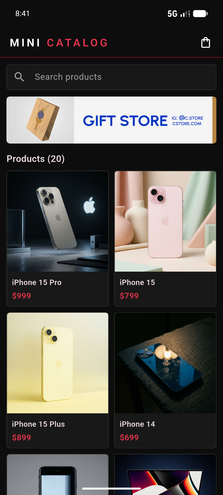
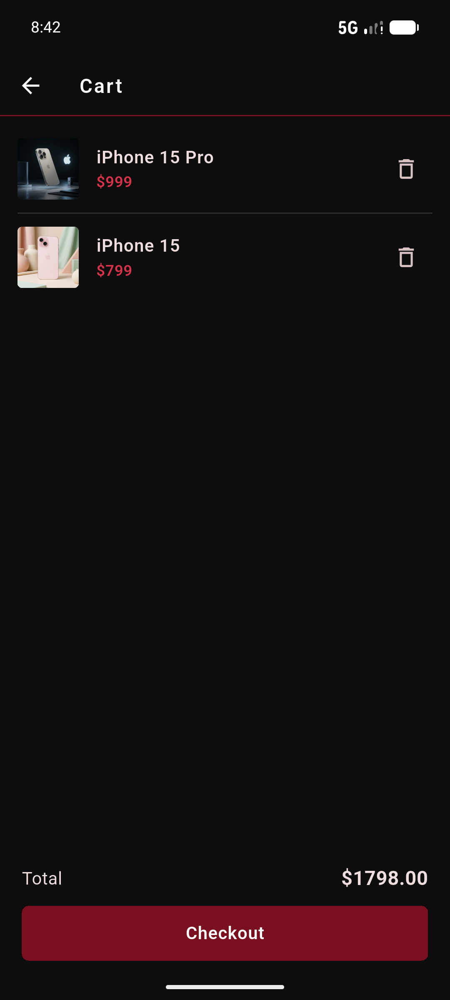

# Mini Catalog App

A simple product catalog app built with **Flutter** as the final project of the Flutter mobile development training. Users can browse products in a grid, search them, open a product detail page and add products to a simulated shopping cart.

## Flutter Version

- Flutter: **3.50.0** (channel stable)
- Dart: **3.14.0**
- Packages: only `material.dart` from the Flutter SDK — no extra packages

> Note: since Flutter 3.47, `flutter analyze` shows an *info* message suggesting the separate `material_ui` package instead of `material.dart`. The training guideline requires `material.dart` and no extra packages, so the app intentionally keeps `material.dart`. This info message does not affect building or running the app.

## Features

- **Home page** – search bar, banner image and product cards in a `GridView`
- **Search** – filters products by name while typing
- **Product detail** – image, price, description and specifications; the product is passed with **route arguments**
- **Cart (simulation)** – add / remove products, see the total, checkout clears the cart
- **Navigation** – `Navigator.pushNamed` / `pop` with **named routes**
- **Data model** – `Product` class with `fromJson` / `toJson`
- **JSON simulation** – products are read from `assets/data/products.json`
- **Assets** – images shown with `Image.asset`
- **Simple state update** – `CartModel` (`ChangeNotifier`) + `ListenableBuilder`
- **Basic theme** – `lib/theme/app_theme.dart`

## Screenshots

| Home | Detail | Cart | Empty cart |
|------|--------|------|------------|
|  |  |  |  |

## How to Run

Requirements: Flutter SDK, Android Studio (Android emulator) or a physical Android device, VS Code.

```bash
git clone https://github.com/Azragull/minicatalog.git
cd minicatalog

# Generate the platform folders (android/, ios/ ...) on the first run
flutter create .

flutter pub get
flutter run
```

Run the tests:

```bash
flutter test
```

## Project Structure

```
lib/
├── main.dart                     # App entry, theme and named routes
├── models/
│   └── product.dart              # Product model (fromJson / toJson)
├── services/
│   └── product_service.dart      # Loads products from the local JSON file
├── state/
│   └── cart_model.dart           # Cart state (ChangeNotifier)
├── theme/
│   └── app_theme.dart            # Basic UI theme
├── screens/
│   ├── home_screen.dart          # Search, banner, product grid
│   ├── product_detail_screen.dart
│   └── cart_screen.dart
└── widgets/
    ├── product_card.dart         # Grid card
    └── cart_button.dart          # Cart icon with item count badge
assets/
├── data/products.json            # Product data (JSON simulation)
└── images/                       # Banner and product images
```

## Data Source

The banner and product data come from the training's demo source
(`https://wantapi.com/assets/banner.png`, `https://wantapi.com/products.php`) and are stored locally in `assets/`.
They are for **educational and demo purposes only** and do not represent a real e-commerce service.
Product names and trademarks belong to their respective owners.
